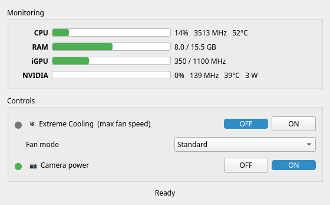

# Legion Performance Controller

Extreme Cooling (fans at maximum) and hardware monitoring for the **Lenovo Legion Y720** on Linux.



Tested on: Legion Y720 (BIOS 4GCN, i7-7700HQ + GTX 1060), CachyOS. Other Y520/Y720-era Legions with the same EC layout may work, but are not a goal of this project.

CPU/GPU performance profiles are intentionally left to the system (`power-profiles-daemon`, `tuned`, KDE power settings).

---

## Architecture

```
┌──────────────────────┐   system D-Bus    ┌───────────────────────────┐
│ legion-perf (GUI)    │ ────────────────▶ │ legion-perfd (root)       │
│ tray + window        │  io.github.       │  polkit check per call    │
│ runs as your user    │  bulbashenko.     │  restores state on resume │
│ reads /proc, /sys    │  LegionPerf       │                           │
└──────────────────────┘                   └──────┬────────────────────┘
                                                  │
                                          ec_sys (EC register 0xBD)
```

- **`legion-perfd`** — a small systemd service and the only privileged part. It exposes a D-Bus API and checks every change with polkit (`io.github.bulbashenko.LegionPerf.configure`). The active local session needs no password; remote and inactive sessions need admin authentication. Reading state is open to everyone.
- **`legion-perf`** — unprivileged Qt tray app. It shows the CPU temperature in the tray icon (green < 70 °C, yellow < 85 °C, red above; a blue frame means Extreme Cooling is on). It always starts in the tray only; clicking the icon (or launching it again from the menu) opens the window with CPU/RAM/iGPU/NVIDIA metrics and the Extreme Cooling switch.
- **State:** Extreme Cooling set through the daemon is re-applied after resume from suspend. After a reboot nothing is touched: the firmware defaults apply, so Extreme Cooling starts off.

## Why Extreme Cooling goes through `ec_sys`

On Windows this is the WMI method `SetFanCooling` on `LENOVO_GAMEZONE_DATA`. On Linux no driver implements it for the Y720:

- the mainline `lenovo-wmi-gamezone` driver only supports SmartFan-capable (2020+) firmware and fails to probe on the Y720;
- LenovoLegionLinux calls a WMI GUID that the Y720 does not have.

`ec_sys` is the least invasive working option. It writes through the kernel's ACPI EC driver with its locking, unlike raw `/dev/port` I/O, and uses the same register and values as LenovoLegionLinux (`EXT_MAXIMUMFANSPEED`).

The proper long-term fix would be `pwm1_enable` support in `lenovo-wmi-gamezone` backed by `SetFanCooling`. The daemon keeps hardware access behind a small `Control` interface (`src/legion_perf/hardware.py`), so such a backend can replace `ec_sys` without touching anything else.

---

### Not supported: `fan_mode` and `camera_power`

`ideapad_laptop` exposes both attributes on the Y720, but the firmware ignores writes and always reads back `0` (verified on BIOS 4GCN38WW). The driver creates them whenever the firmware answers the read command, so their presence in sysfs does not mean they work.

---

## Installation (Arch / CachyOS)

```bash
cd packaging/arch
makepkg -si
sudo systemctl enable --now legion-perfd
```

The package builds from the **committed** `HEAD` of this repository. It installs:

| Path | Purpose |
|---|---|
| `/usr/bin/legion-perfd`, `/usr/bin/legion-perf` | daemon and GUI |
| `/usr/lib/systemd/system/legion-perfd.service` | hardened systemd unit |
| `/usr/share/dbus-1/system.d/…`, `system-services/…` | D-Bus policy and activation |
| `/usr/share/polkit-1/actions/io.github.bulbashenko.LegionPerf.policy` | polkit action |
| `/usr/lib/modules-load.d/legion-perf.conf`, `/usr/lib/modprobe.d/legion-perf.conf` | load `ec_sys` with `write_support=1` at boot |
| `/etc/xdg/autostart/legion-perf.desktop` | start the GUI in the tray on login |

Remove with `sudo pacman -R legion-perf`.

### Migrating from v1 (`legion_perf.py`)

```bash
sudo rm -f /usr/local/bin/legion-perf-helper /etc/polkit-1/actions/io.github.legion.perf.policy
rm -f ~/.local/bin/legion-perf ~/.local/share/applications/legion-perf.desktop \
      ~/.config/autostart/legion-perf.desktop
```

---

## D-Bus API

Bus name and interface `io.github.bulbashenko.LegionPerf`, object `/io/github/bulbashenko/LegionPerf`.

| Member | Type | |
|---|---|---|
| `Features` | property `as` | `extreme-cooling` when `ec_sys` is available |
| `ExtremeCooling` | property `b` | |
| `Version` | property `s` | |
| `SetExtremeCooling(b)` | method | polkit-checked |

Changes emit `org.freedesktop.DBus.Properties.PropertiesChanged`. From the shell:

```bash
busctl get-property io.github.bulbashenko.LegionPerf /io/github/bulbashenko/LegionPerf \
  io.github.bulbashenko.LegionPerf ExtremeCooling
busctl call io.github.bulbashenko.LegionPerf /io/github/bulbashenko/LegionPerf \
  io.github.bulbashenko.LegionPerf SetExtremeCooling b true
```

Errors: `….Error.NotAuthorized`, `….Error.NotSupported`, `….Error.Hardware`.

---

## Development

```bash
python -m venv --system-site-packages .venv   # PySide6 from the system package
.venv/bin/pip install -e ".[gui,dev]"

.venv/bin/ruff check src tests && .venv/bin/ruff format --check src tests
.venv/bin/mypy
.venv/bin/pytest
```

The tests never touch real hardware. The daemon runs against a fake sysfs/debugfs tree on a private `dbus-daemon`, with polkit replaced by a test authorizer, and the GUI client is tested against that daemon in a subprocess. CI runs the same checks on GitHub Actions.

To run the daemon by hand without root, on the session bus and without polkit:

```bash
.venv/bin/legion-perfd --session --root /path/to/fake/root -v
```

---

## Troubleshooting

**Window says "Daemon is not available"** — `systemctl status legion-perfd` and `journalctl -u legion-perfd`.

**Extreme Cooling switch is missing** — `ec_sys` is not loaded with write support. Check that `cat /sys/module/ec_sys/parameters/write_support` prints `Y`, and that `/sys/kernel/security/lockdown` shows `[none]` (kernel lockdown blocks debugfs writes).

**NVIDIA row shows "suspended (D3)"** — the dGPU is runtime-suspended and is deliberately not polled, because `nvidia-smi` would wake it. Pascal cards such as the GTX 1060 do not support runtime D3, so on the Y720 the row always shows live data.

---

## License

GPL-3.0 — see [LICENSE](LICENSE). The v1 single-file version is kept in the [`v1`](../../tree/v1) branch.
